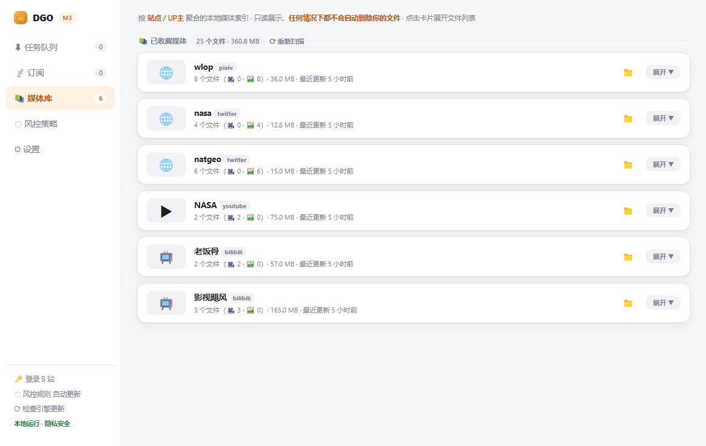
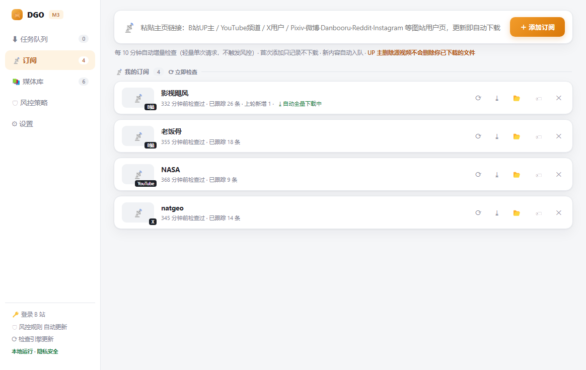
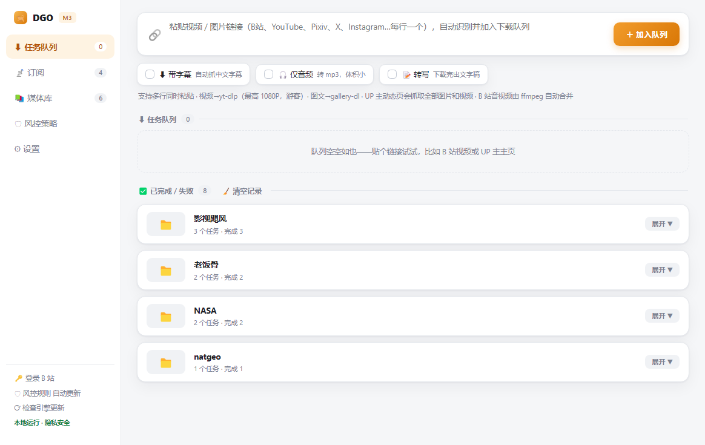

# Keepsake

订阅式媒体归档器——贴一次主页链接（B站 UP 主 / 推特 / 微博 / Pixiv / Instagram 等 15+ 图视频站，加上 yt-dlp 支持的 1000+ 单链接站点），作者之后新发的内容自动下载归档。源头删帖能检测到，并对照指出本地已存的是哪个文件。全流程本地运行，无账号、无上传、无追踪。

> Windows 10 / 11 64 位（macOS 版规划中，见文末 Roadmap）

| 媒体库 | 订阅归档 | 下载队列 |
|:---:|:---:|:---:|
|  |  |  |

## 为什么是 Keepsake

市面下载器解决「这一条我要」，Keepsake 解决「这个主页我全要」（Keepsake 意为值得留住的纪念物——源头删了，你的收藏还在）：

- 订阅归档：贴主页链接 → 首次全量回溯历史发布 → 之后每 10 分钟自动增量拉新
- 删帖感知：源帖被删时订阅卡片提示，并对应指出本地已保存的是哪个文件（归档党的安全感）
- 同一主页里图片和视频一起下载，混发不漏
- whisper 离线转写出字幕/文稿，全程不出本机；要摘要/翻译可以接自备的 API，密钥只存本机
- 媒体库按发布时间排序，可按 UP主 / 站点 / 文件名关键词搜索，一键打开所在文件夹
- 限流自动退避冷却 + 策略热更新，不用升级软件就能应对新风控

## 常用功能

- B 站扫码登录：左下角侧栏点击登录，登录后可下高清、抗风控
- 其他站点 Cookie：浏览器装扩展「Get cookies.txt LOCALLY」导出 → ⚙设置 → 导入合并
- 本地转写：⚙设置下载转写模型（推荐 Turbo 547MB）→ 任务勾「📝转写」→ 同目录出 .srt 字幕 + .txt 文稿，全程离线、隐私不出本机
- 风控自愈：连续失败自动退避冷却并显示恢复倒计时；策略热更无需升级软件

## 首次运行说明（联网下载组件）

出于第三方许可证合规（gallery-dl 为 GPL-3.0），Keepsake 安装包不捆绑 gallery-dl 与 FFmpeg，
首次运行时由软件自动从官方发布页下载到本机用户目录（一次性，约 1~2 分钟，视网速）。
不联网完成这一步时，部分站点功能暂不可用，下载完成后自动恢复全功能。

下载内置了多源容错：gallery-dl 取自 Codeberg 官方发布（带 SHA-256 校验），FFmpeg 走 gyan.dev（备选 BtbN），
GitHub 直连不通时自动切国内镜像。若仍失败，重启软件即可重试；也可在 ⚙设置 →
「📥 从本地文件安装」手动导入已下载的 .exe/.zip。

## 常见问题

| 现象 | 处理 |
|------|------|
| 任务显示「风控限流」 | 等几分钟自动重试；或左下角扫码登录 B 站 |
| 下载的文件在哪 | 完成通知里写了保存路径；媒体库页每条都能一键打开 |
| 软件关了下载还在吗 | 缩到托盘了，任务继续跑；托盘「退出」才真正停止 |
| 首次打开提示「引擎尚未就绪」 | 等首启组件下载完（见上节，自带国内镜像容错）；反复出现请检查杀毒软件是否拦截 |
| Windows 提示「SmartScreen 已保护」 | 点「更多信息 → 仍要运行」。当前版本无代码签名证书，属正常提示 |
| 换电脑搬家 | 把下载目录整个拷走即可，本程序不锁文件 |

## 当前版本说明

功能还在持续打磨，可能有 Bug，重要资料请自行备份。

## Roadmap

- 小红书：依赖的上游下载器暂无该站支持（稳定版与开发分支都实测过没有），等上游或后续专项
- macOS 版：核心链路已跑通，打包分发规划中
- 安装包代码签名（消除 SmartScreen 提示）

## 第三方组件

Keepsake 自身代码为专有软件（见 [LICENSE](LICENSE)）；依赖的 yt-dlp / gallery-dl / FFmpeg / whisper.cpp 等
开源组件的许可与分发方式见 [THIRD-PARTY-NOTICES.md](THIRD-PARTY-NOTICES.md)。

---

仅限下载自己有权保存的内容，请遵守各网站服务条款与当地法律。
